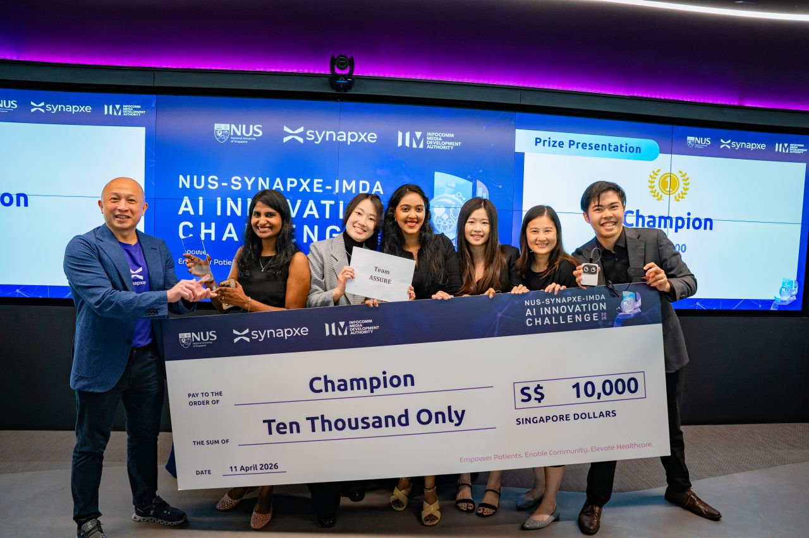

# ASSURECare – Voice Assistant Prototype

A voice-enabled AI assistant prototype developed as part of **ASSURECare**, an elderly cardiac monitoring solution created for the NUS–Synapxe–IMDA AI Innovation Challenge 2026.

This repository contains the Raspberry Pi 4 voice chatbot prototype, which enables users to interact with an AI assistant through spoken conversations. It combines speech recognition, LLM-powered response generation and text-to-speech synthesis.

## 🏆 Award – NUS–Synapxe–IMDA AI Innovation Challenge 2026

**Team ASSURE won the challenge**, competing against 181 teams and more than 800 participants.



## My Contribution

Contributed to the overall solution design, helping shape the concept and approach behind ASSURECare. I was also involved in developing the presentation and pitch, communicating the solution's value proposition, design and potential impact to the judges.

---

## How It Works

The prototype uses a speech-to-speech pipeline:

1. **Audio Input:** `arecord` captures microphone audio.
2. **Speech-to-Text:** ElevenLabs STT converts speech into text.
3. **Response Generation:** OpenAI generates a conversational response.
4. **Text-to-Speech:** ElevenLabs TTS converts the response into audio.
5. **Audio Output:** `aplay` plays the generated response.

## Interaction Modes

Two runnable prototypes are included:

| Script | Description |
|---|---|
| `assurebot.py` | Manual turn-taking. Press Enter to record audio or enter text directly. |
| `assure_dynamic_bot.py` | Automatic turn-taking. Detects speech, starts recording and sends the input after a period of silence. |

The dynamic prototype uses voice activity detection to determine when a user has finished speaking.

**Note:** The dynamic version is not a real-time streaming implementation. It uses batch ElevenLabs STT, blocking OpenAI response generation and blocking ElevenLabs TTS.

## Tech Stack

| Component | Technology |
|---|---|
| Hardware | Raspberry Pi 4 |
| Language | Python |
| Speech Recognition | ElevenLabs Speech-to-Text (`scribe_v2`) |
| Response Generation | OpenAI API (`gpt-4o-mini`) |
| Speech Synthesis | ElevenLabs Text-to-Speech (`eleven_flash_v2_5`) |
| Audio Input/Output | ALSA (`arecord`, `aplay`) |
| Dependency Management | Poetry |

## Setup and Installation

### Prerequisites

- Raspberry Pi 4
- Python environment
- Microphone and speaker
- OpenAI API key
- ElevenLabs API key
- ALSA audio utilities

Install the ALSA utilities:

```bash
sudo apt-get update
sudo apt-get install -y alsa-utils
```

Check available audio devices:

```bash
arecord -l
aplay -l
```

### 1. Set Up the Environment

This project uses Poetry for dependency management. The following setup uses an existing `venv/` environment:

```bash
source venv/bin/activate
pip install poetry
poetry config virtualenvs.create false
poetry install
```

### 2. Configure Environment Variables

Create a `.env` file in the project root:

```env
ELEVENLABS_API_KEY=your_elevenlabs_api_key
OPENAI_API_KEY=your_openai_api_key

ELEVENLABS_VOICE_ID=your_voice_id
OPENAI_MODEL=gpt-4o-mini
ELEVENLABS_STT_MODEL=scribe_v2
ELEVENLABS_TTS_MODEL=eleven_flash_v2_5
ELEVENLABS_TTS_OUTPUT_FORMAT=pcm_16000
```

`ELEVENLABS_VOICE_ID` is optional. If omitted, the script fetches the available voices and uses the first one.

The model settings are also optional and can be adjusted depending on the desired voice and response latency.

**Important:** Do not commit your `.env` file or API keys to GitHub.

## Running the Prototypes

### 1. Manual Voice Mode

```bash
source venv/bin/activate
python assurebot.py
```

Press Enter to record audio or enter text directly.

**Text-only API test:**

Useful for checking API connectivity without requiring a microphone or speaker.

```bash
python assurebot.py --once --no-tts --text "Good morning, I checked my blood pressure, it is 128 over 78."
```

**One-turn voice test:**

Records six seconds of audio and generates a spoken response.

```bash
python assurebot.py --once
```

### 2. Automatic Voice Mode

```bash
source venv/bin/activate
python assure_dynamic_bot.py
```

The prototype automatically detects speech and sends the recording for processing after detecting silence.

**Specify audio devices:**

```bash
python assurebot.py --mic-device plughw:1,0 --speaker-device plughw:0,0
```

For automatic mode with VAD debugging:

```bash
python assure_dynamic_bot.py --mic-device plughw:1,0 --speaker-device plughw:0,0 --debug-vad
```

### Voice Detection Configuration

The automatic prototype supports parameters for adjusting speech detection:

- `--vad-threshold`: Increase the threshold if background noise triggers recording.
- `--end-silence-ms`: Increase the duration if speech is cut off too early. Decrease it if the response feels delayed after speaking.

Example:

```bash
python assure_dynamic_bot.py --vad-threshold 900 --end-silence-ms 700
```

## Limitations and Future Improvements

The current implementation is a manually tested Raspberry Pi 4 prototype.

Potential areas for further development include:

- Real-time speech recognition using WebSocket streaming.
- Lower-latency response generation and speech synthesis.
- Improved speech detection in noisy environments.
- More natural conversational turn-taking.

The current implementation does not include automated audio testing or real-time streaming.

## API Documentation and References

**ElevenLabs**
- [Speech-to-Text API](https://elevenlabs.io/docs/api-reference/speech-to-text/convert)
- [Text-to-Speech API](https://elevenlabs.io/docs/api-reference/text-to-speech/convert)
- [Available Models](https://elevenlabs.io/docs/overview/models)
- [Realtime Speech-to-Text](https://elevenlabs.io/docs/api-reference/speech-to-text/v-1-speech-to-text-realtime)
- [WebSockets](https://elevenlabs.io/docs/websockets)
- [Python SDK](https://github.com/elevenlabs/elevenlabs-python)

**OpenAI**
- [GPT-4o mini](https://developers.openai.com/api/docs/models/gpt-4o-mini)
- [GPT-5 mini](https://developers.openai.com/api/docs/models/gpt-5-mini)
- [GPT-5 nano](https://developers.openai.com/api/docs/models/gpt-5-nano)
- [Realtime API](https://platform.openai.com/docs/guides/realtime)

---
